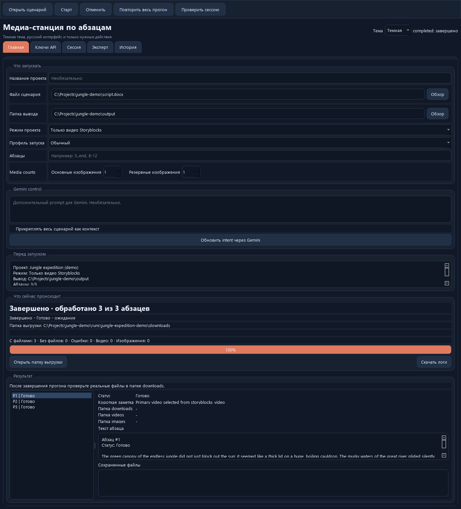
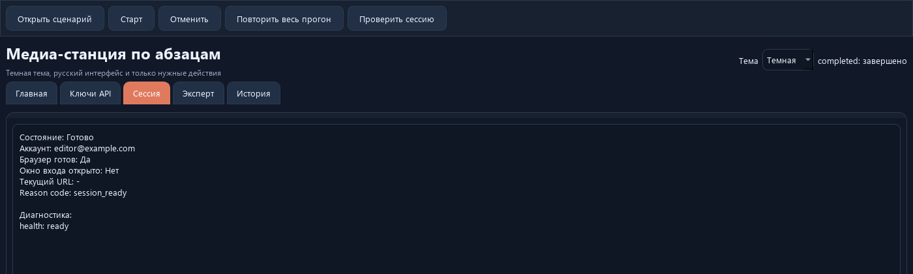

<h1 align="center">Stock Importer</h1>

<p align="center">
  A desktop tool that reads a video script paragraph by paragraph and sources matching stock footage and images for each one.
</p>

<p align="center">
  
  
  
  
  <a href="https://github.com/nikito4kv/stock-importer/actions/workflows/ci.yml"></a>
  
</p>

---

## What it does

Video editors working from a written script spend hours searching stock libraries one scene at a time.
Stock Importer automates that loop:

1. **Import** a numbered script from a `.docx` file. Paragraphs are split, numbering is validated, and problems
   (sequence gaps, a script not starting at 1, empty numbered paragraphs) are reported before anything runs.
2. **Understand** each paragraph. A heuristic step builds search intents instantly without any network call.
   Optionally, Gemini enriches them (subject, action, setting, mood, negative terms, translated queries).
   This is an explicit button in the UI, never part of file import.
3. **Search** for media per paragraph in one of five project modes: Storyblocks video, Storyblocks video plus
   Storyblocks images, Storyblocks video plus free images, Storyblocks images plus free images, or free images only.
   Storyblocks is driven through a real Chrome or Edge profile with Playwright. Free images come from
   Pexels, Pixabay and Openverse.
4. **Filter and rank** candidates: license policy (commercial use only by default), image payload validation,
   de-duplication (source id, raw hash, perceptual hash, semantic signature) and early stop once a paragraph
   has enough good matches.
5. **Download** the winners into a per-project `downloads/` folder split into `videos/` and `images/`, and write a
   run manifest so a run can be inspected, cancelled and repeated.

The pipeline as it exists in the code:

```text
 script.docx
     |
     v
 [ingestion]  paragraphs + numbering validation      (pipeline/ingestion.py)
     |
     v
 [intents]    heuristic bootstrap  --(optional, explicit)-->  Gemini enrichment
     |                                                        (pipeline/intents.py)
     v
 [orchestrator]  bounded worker pool, cancel, run state       (pipeline/orchestrator.py)
     |
     +--> provider search   Storyblocks video / images  (Playwright)
     |                      Pexels / Pixabay / Openverse (HTTP + SQLite cache)
     v
 [media pipeline]  license filter -> quality rank -> dedupe -> download -> persist
     |                                                        (pipeline/media.py)
     v
 workspace/runs/<project>/downloads/{videos,images} + run manifest + perf.jsonl
```

## Screenshots

The screenshots were rendered from the real Qt window in headless mode (`QT_QPA_PLATFORM=offscreen`) with demo data
only: a sample script from `docs/benchmarks/fixtures/`, a stub search backend instead of
Storyblocks, no network and no API keys. The interface language is Russian.

<p align="center">
  
</p>

<p align="center">
  
</p>

## Why it is interesting

These are decisions you can verify in the code, not marketing claims.

- **Layered architecture.** `ui` talks to a controller, the controller talks to `DesktopApplication`, which wires
  `pipeline`, `browser`, `storage` and `providers` in one composition root (`app/bootstrap.py`). The layer rules
  are written down in `CONTRIBUTING.md`; `tests/test_phase2_architecture.py` covers bootstrap, the Qt-only launch
  path, the single Storyblocks profile and orchestrator behaviour.
- **Legacy code is quarantined behind adapters.** The original CLI-era helpers live in `legacy_core/`. New modules
  (`providers/images/`, `pipeline/ingestion.py`) wrap them instead of importing them all over the place.
- **Expensive AI is kept off the hot path.** Opening a script is heuristic-only. Gemini is a deliberate follow-up
  action, with a character budget for the full-script context (`AiSettings`).
- **Concurrency that respects the provider.** `providers/concurrency.py` resolves an execution mode
  (`storyblocks_safe`, `free_images_parallel`, `mixed_safe`) from the enabled providers. Anything that touches
  Storyblocks keeps paragraph workers serial, because the site is driven through one logged-in browser session.
  Work inside a paragraph uses a `BoundedExecutor` with a bounded queue and back-pressure statistics.
- **Explicit auth diagnostics instead of silent fallbacks.** The Storyblocks session has a state machine
  (`unknown`, `ready`, `login_required`, `challenge_detected`, `expired`, `blocked`) and every transition carries a
  reason code. A DOM contract checker validates search pages against saved HTML fixtures
  (`tests/fixtures/storyblocks/`) so a layout change fails loudly.
- **Persistence you can trust.** JSON documents are written through a temp file plus `os.replace`. Models are
  dataclasses with a generic serializer and `schema_version` fields. The image search cache is SQLite in WAL mode
  with a TTL and periodic cleanup. Pexels/Pixabay keys and the Gemini key are stored through Windows DPAPI.
- **Defensive downloads.** Image bytes are decoded with Pillow before they are accepted (size, pixel-count and
  content-type checks, SVG rejected). Remote URLs go through a public-host check. Licenses are filtered by policy.
- **Observability and benchmarks.** Every run carries a `PerformanceContext` (counters and timings) and the event
  bus writes `app.log` and `perf.jsonl`. `app/benchmark_phase0.py` replays small, medium and large fixture scripts
  against synthetic providers with fixed delays so changes can be compared (see `docs/benchmarks/`).
- **Release path.** `release_tools/portable.py` builds a portable Windows bundle with setup and smoke-test
  scripts (`docs/phase-10/`).

## Tech stack

| Area | Technology |
| --- | --- |
| Language | Python 3.13 (dataclasses, `Protocol`, type hints throughout) |
| Desktop UI | PySide6 (Qt for Python) with a dark and a light theme |
| Browser automation | Playwright, real Chrome or Edge profile, persistent context |
| AI | Google Gemini via `google-genai` (`gemini-2.5-flash` by default) |
| Script parsing | `python-docx` |
| Images | Pillow, Pexels, Pixabay and Openverse clients |
| Retries | `tenacity` plus a small in-house retry helper |
| Storage | JSON workspace (projects, runs, manifests, presets) and SQLite caches |
| Quality | `unittest`, Ruff (`E`, `F`, `I`, `B`), GitHub Actions |

## Quick start

Windows is the primary target (DPAPI secret storage, Chrome/Edge profile import). You need CPython 3.13 and
Chrome or Edge installed.

```powershell
git clone https://github.com/nikito4kv/stock-importer.git
cd stock-importer

# create a virtual environment from a real CPython 3.13 install
C:\path\to\python.exe -m venv .venv
.venv\Scripts\python.exe -m pip install -r requirements.txt

# startup smoke test without opening the GUI
.venv\Scripts\python.exe -m app --smoke --no-gui

# launch the desktop app
.venv\Scripts\python.exe -m app
```

### API keys

In the desktop app, keys are entered on the "Ключи API" tab and stored encrypted in the local `workspace/`
folder (Windows DPAPI). Nothing is written to the repository.

`.env.example` documents the environment variables used by the legacy command-line scripts and as a fallback for
the free image providers. Copy it to `.env` and fill in your own values:

```dotenv
GEMINI_API_KEY=your_gemini_api_key_here
PEXELS_API_KEY=
PIXABAY_API_KEY=
```

Storyblocks needs an account of your own. The app does not ship credentials. You sign in once in the browser
window it opens (or import an existing Chromium session) and the profile is reused afterwards.
Openverse works without a key.

## Project structure

```text
app/         composition root, DesktopApplication use cases, benchmark runner, `python -m app`
ui/          PySide6 window, controller, view-model contracts, launch profiles, polling
pipeline/    ingestion, intent generation, media selection, run orchestrator, back-pressure, perf
providers/   provider registry and descriptors, free-image clients, SQLite search cache, concurrency modes
browser/     Storyblocks session state machine, Playwright and native browser launch, profile import, DOM contract
storage/     workspace layout, repositories, atomic JSON serialization
services/    event bus, JSON-line logging, settings manager, DPAPI secret store, Gemini adapter, retries, errors
domain/      source-of-truth dataclass models, enums, project modes
config/      typed application settings
legacy_core/ older shared helpers kept behind adapters (relevance cache, network guards, query utils)
release_tools/ portable Windows bundle builder
tests/       unittest suites and Storyblocks HTML fixtures
docs/        benchmark runbook and baseline, optimization checklists, release notes, screenshots
```

`image_fetcher.py`, `video_fetcher.py` and `keyword_extractor.py` in the repository root are the original
standalone command-line scripts. They are not used by the desktop app and are kept for reference and compatibility.

## Tests and quality

- 16 test modules and 162 test cases (`unittest`), plus 7 saved Storyblocks HTML fixtures.
- Covered areas: script ingestion and numbering, intent parsing and query building, the media pipeline,
  run lifecycle and cancellation, caching and network guards, Storyblocks session diagnostics, UI controller
  and polling, portable release tooling.
- Most tests run against stub backends and temporary workspaces, so they need no network, no browser and no keys.

```powershell
.venv\Scripts\python.exe -m pip install ruff
.venv\Scripts\python.exe -m ruff check .
.venv\Scripts\python.exe -m unittest discover -s tests
```

Last local run: `ruff check .` clean; `unittest discover` ran 162 tests, all passing (about two minutes).
That run used Python 3.14.6 because a 3.13 interpreter was not available on the machine. On Python 3.12 two
modules fail to import (`threading.Lock | None` annotations need 3.13+), which is why 3.13 is the supported
baseline. CI runs Ruff and the full test suite on Python 3.13 for every push and pull request.

## Status and roadmap

Status: working personal tool, actively refactored. The core flow (import, intents, Storyblocks and free-image
search, download, manifests) is implemented and covered by tests. It is not packaged as a polished product.

Known limits and plans:

- Storyblocks automation depends on the site's DOM and on a human signing in. The selector catalog and the DOM
  contract checker exist to make breakage visible, but selectors will need maintenance.
- The desktop UI is in Russian only.
- Windows first. On other platforms the secret store falls back to base64, which is not encryption.
- Benchmarks so far are synthetic (fixed provider delays, no real network). A production baseline template exists
  in `docs/benchmarks/` but has not been filled in.
- The three legacy scripts in the repository root are candidates for removal once nothing depends on them.
- Screenshots are demo renders; there is no recorded end-to-end video yet.

## License

MIT, see [LICENSE](LICENSE).

---

Built by [Nikita Lapa](https://github.com/nikito4kv) · built with an AI-assisted workflow
